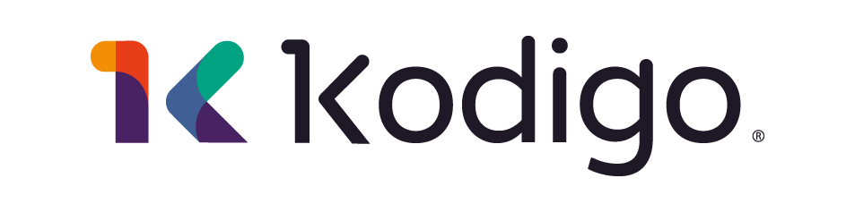

<h3 align="center">
  <picture>
    <source media="(prefers-color-scheme: dark)" srcset="https://raw.githubusercontent.com/kodigo-grupo-12/.github/main/Assets/kodigo_logo_dark.png">
    <source media="(prefers-color-scheme: light)" srcset="https://raw.githubusercontent.com/kodigo-grupo-12/.github/main/Assets/kodigo_logo.png">
    
  </picture> 
  
  AI For Devs Jr. 5 — Grupo 12
  
</h3>

<h6 align="center">
  <a href="https://github.com/kodigo-grupo-12/monorepo">Monorepo</a>
  ·
  <a href="https://github.com/kodigo-grupo-12/documentacion">Documentación</a>
  ·
  <a href="https://kodigo-grupo-12.github.io/documentacion/">Sitio</a>
</h6>

<h3 align="center">
  
  &nbsp;&nbsp;
  
</h3>

  

&nbsp;

  Organización destinada a almacenar los repositorios y entregables del <strong>Grupo 12</strong> 
  para el programa <strong>AI For Devs Jr. 5</strong> de <strong>Kodigo</strong>. 
  <em>Formamos talento tech en El Salvador y Latinoamérica</em>

  <strong>INSTRUCTOR</strong> 
  Ing. Ronald Mejía

  <strong>INTEGRANTES</strong> 
  Roberto Carlos Flores Quintanilla 
  Raúl Alfredo Hernández Miranda

  <strong>FECHA DE ENTREGA</strong> 
  Domingo, 29 de noviembre de 2026 — 23:59

&nbsp;
